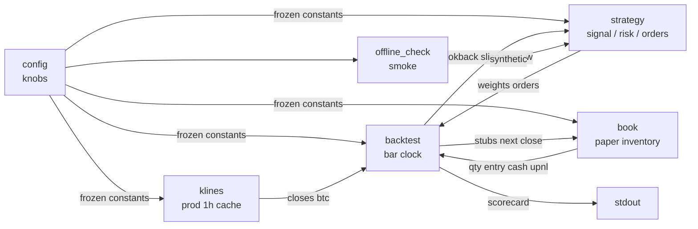

# CSZN backtester

Proof of the residual fade after costs. Same frozen rules as live. No optimizer. No demo candles.

Live (`run.py`) still sends to demo futures. This tape is **production** USDT-M 1h closes from `https://fapi.binance.com`.

Any human or agent that changes knobs and re-runs this clock must follow **`docs/cszn-backtest-constitution.md`**. That document outranks a green scorecard.

## Concern graph



Live `exchange.py`, `run.py`, and `ops.py` are not in this graph.

## Files

| File | Role | Input | Output |
|---|---|---|---|
| `config.py` | Same knobs as live, plus backtest paths. | Environment. | Constants. |
| `strategy.py` | Unchanged fade math. | Close window, prior weights, book. | Weights, order stubs. |
| `sim/klines.py` | Fetch or read the 1h cache. | Prod fapi or CSV. | Asset closes, Bitcoin closes. |
| `sim/book.py` | Paper futures inventory. | Stubs, next-bar price. | Qty, entry, cash, fees, upnl. |
| `sim/backtest.py` | Bar clock and scorecard. | Panel + knobs. | Printed verdict. |
| `sim/offline_check.py` | Smoke tests. Not replaced. | Synthetic panel. | Asserts. |

## Simons rules this file enforces

1. **One bet.** Cross-sectional residual fade vs Bitcoin. No extra signals.
2. **Frozen knobs.** `Z_MIN`, windows, stop, fees, universe stay as in `config.py`. This program does not search.
3. **No lookahead.** Signal at bar `t` uses closes through `t` and a lookback of `KLINE_LIMIT` (same cap as live). Fills at close `t+1`.
4. **Costs on.** Every fill pays `FEE_BPS`. Net pnl is after fees.
5. **Scarce risk.** Same collateral and gross caps as live.
6. **No account halt in the score.** Live flatten-on-drawdown is operations. Here max drawdown is reported so the fade is not censored.
7. **No take-profit.** Winners ride until `|Z|` dies or the per-name stop hits. Live stop is 0.6% checked every 60s; this hourly backtest cannot simulate that fuse.

## Bar nodes

Each `t` after warmup, before the last bar:

| Node | Input | Output |
|---|---|---|
| mark | book, close `t` | equity, upnl |
| risk | equity | collateral, gross |
| slice | full tape, `t` | last `KLINE_LIMIT` bars |
| signal | slice, `prev_w` | `target_weights` |
| orders | weights, book, gross | `rebalance_orders` (stop / signal_off / no-add) |
| fill | stubs, close `t+1` | `apply_fills` |

## Cache

Path: `var/klines_1h.csv` (gitignored).

First run downloads about `BACKTEST_DAYS` (default 730) of 1h closes for the frozen universe plus Bitcoin. Later runs read the file. Set `BACKTEST_REFRESH=1` to download again.

This is a cache, not a datalake: one CSV, wide closes, inner-joined timestamps.

## Run

```bash
cd cszn_trader
source .venv/bin/activate
python sim/backtest.py
BACKTEST_REFRESH=1 python sim/backtest.py
```

## Scorecard

| Field | Meaning |
|---|---|
| `net_pnl` / `ret` | Equity after fees minus start margin. The verdict. |
| `max_dd` | Peak-to-trough on marked equity. |
| `turnover` / `fees` | Sum of filled notional and commissions. |
| `time_in_mkt` | Fraction of bars with any open qty. |
| `stop` / `signal_off` / `rebalance` | Exit-reason counts. |

If `net_pnl` is not positive after costs on this frozen tape, there is no edge to run live. Do not add knobs to rescue the number. See the [constitution](cszn-backtest-constitution.md) for search / agent constraints.

## Knobs (backtest only)

| Constant | Default | Role |
|---|---|---|
| `BACKTEST_FAPI` | `https://fapi.binance.com` | Prod public klines. |
| `BACKTEST_DATA` | `var/klines_1h.csv` | Cache path. |
| `BACKTEST_MARGIN` | `4000` | Starting paper equity. |
| `BACKTEST_DAYS` | `730` | Calendar days to cache. |
| `BACKTEST_REFRESH` | off | Force re-download. |
