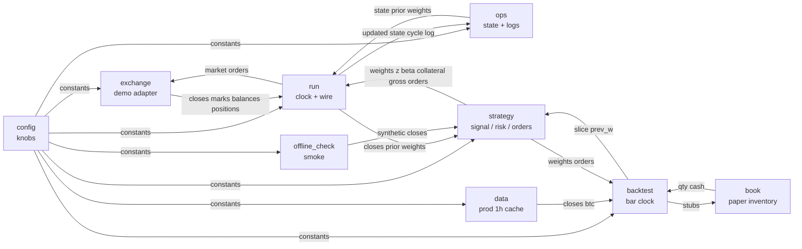

# Residual futures trader

This package trades a dollar-neutral residual book on Binance United States dollar margined demo futures. Bitcoin is the common factor only and is never a target name. The loop is mechanical: fixed clock, fixed rules, and scarce risk.

## Concern graph

Each file is a node. Edges are the data that pass between nodes.



## Files

| File | Role | Input | Output |
|---|---|---|---|
| `cszn_trader/config.py` | Knobs only. | Environment file. | Module constants. |
| `cszn_trader/strategy.py` | Pure math. | Closes, margin, weights, prices. | Weights, budgets, order stubs. |
| `cszn_trader/exchange.py` | Demo Hypertext Transfer Protocol client. | Credentials and method arguments. | Candles, marks, balances, fills. |
| `cszn_trader/ops.py` | Persistence and kill switch. | State dictionary and margin. | Updated state and log path. |
| `cszn_trader/run.py` | Wires the graph on a clock. | Client and state. | Orders, logs, sleep until wake time. |
| `cszn_trader/offline_check.py` | Offline smoke test. | Synthetic prices. | Printed ranks and orders. |
| `cszn_trader/data.py` | Production 1h close cache. | Prod fapi or CSV. | Asset closes, Bitcoin closes. |
| `cszn_trader/book.py` | Paper futures inventory. | Order stubs, next close. | Qty, entry, cash, fees. |
| `cszn_trader/backtest.py` | Bar clock for proof of edge. | Panel and frozen knobs. | Scorecard after costs. |

There is no `binance_futures.py`. The adapter lives in `exchange.py`. The backtester never calls it. See `docs/cszn-backtest.md` and `docs/cszn-backtest-constitution.md`.

## Strategy sub-nodes

| Sub-node | Methods | Input | Output |
|---|---|---|---|
| signal | `rolling_beta`, `residuals`, `residual_signal`, `cross_sectional_z`, `sparse_z`, `dollar_neutral_weights`, `beta_neutralize`, `apply_weight_deadband`, `target_weights` | Asset closes, Bitcoin closes, prior weights | Unit-gross weights, z-scores, betas |
| risk | `collateral_from_margin`, `gross_notional_budget`, `derived_im`, `cap_name_weights` | Margin, positions, marks | Collateral cap, gross budget, estimated initial margin |
| orders | `cost_floor`, `rebalance_orders` | Weights, prices, positions, entry, unrealized, gross | Order stubs with `exit_reason`, closes first |

Beta hedge runs only inside names that pass the z-score floor, so weak names stay at zero weight and portfolio Bitcoin exposure stays near zero on the active set.

## Exchange client

| Method | Input | Output |
|---|---|---|
| `klines` | Symbol, interval, limit | Candle rows |
| `mark` | Symbol | Mark price |
| `filters` | Symbol | Lot step and minimum notional |
| `margin_balance` / `available_balance` | None | Account balances |
| `positions` / `position_book` | None | Signed quantity, or qty plus entry / mark / unrealized |
| `set_leverage` / `market` | Symbol, side, quantity | Order response |
| `income_since` | Start time | Sums by income type |
| `detect_hedge_mode` | None | Hedge-mode flag |

## Operations

| Method | Input | Output |
|---|---|---|
| `load_state` / `save_state` | Path or state | State dictionary or disk write |
| `weights_from_state` | State | Prior weight series |
| `log_cycle` | Cycle row | Append path under `logs/cszn/` |
| `update_peak_and_kill` | State and margin | State, possibly halted |

## Run cycle stages

`once` walks these labeled nodes in order: market, signal, halt, risk, orders, execute, persist. `main` polls on a short clock (default ten minutes). Adds fire only when z-score floor, weight deadband, and cost floor clear. Exits do not wait on those gates: a name is flattened when the signal zeros it, or when unrealized loss on that name reaches `STOP_PCT` of its notional. Underwater names are never increased. Cover orders are queued before new risk so initial-margin checks cannot skip a flatten. Each stub logs `exit_reason` as `signal_off`, `stop`, or `rebalance`. There is no take-profit.

```mermaid
flowchart TD
  A[Boot: config and state] --> B[Market: demo candles and marks]
  B --> C[Signal: beta strip and residual ranks]
  C --> D[Signal: sparse z-scores and dollar-neutral weights]
  D --> E{Drawdown halt?}
  E -->|yes| F[Flatten all positions then persist]
  E -->|no|   G[Risk: collateral and gross caps]
  G --> H{Exit or add edge?}
  H -->|signal_off / stop| L
  H -->|no add edge| I[Hold: log and persist]
  H -->|add gates clear| J{Dry run?}
  J -->|yes| K[Log targets only]
  J -->|no| L[Execute closes first, then adds under IM cap]
  I --> M[Poll sleep until next stamp]
  K --> M
  L --> M
  F --> M
```

## Default knobs

One-hour bars kept for signal stability. Beta window forty-eight. Residual lookback twelve. Z-score clip three and minimum one. Collateral five percent of margin with a two-hundred United States dollar ceiling. Leverage five. Gross at most twenty-five percent of margin. Weight deadband three percent. Minimum rebalance forty United States dollars on adds only. Per-name stop one point two percent of that name's notional, no take-profit. Poll every ten minutes (`POLL_SECONDS`, alias `REBALANCE_SECONDS`). Halt and flatten after three percent drawdown from peak margin. Dry run defaults on.

Traded universe is eighteen liquid perpetual names plus Bitcoin as benchmark only. Credentials load from the project-root `.env` file. Demo host defaults to `https://demo-fapi.binance.com` for both market data and orders.

## Limits

There is no automated proof that the residual signal earns money after costs. Demo candle history is short for stable beta. Universe liquidity is not re-screened every cycle. Clearing a halt requires editing or deleting `state.json`.
