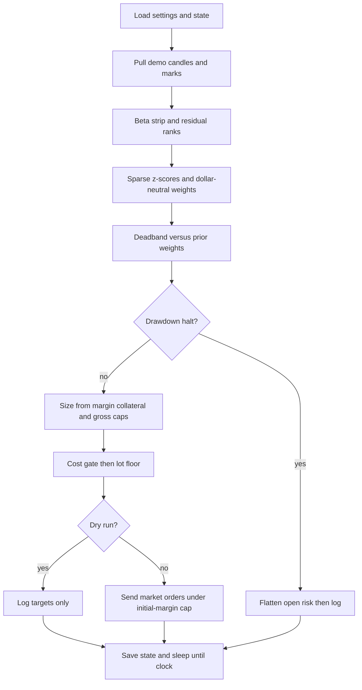

# Residual futures trader

This package trades a dollar-neutral residual book on Binance United States dollar margined demo futures. Bitcoin is the common factor only and is never a target name. The loop is mechanical: fixed clock, fixed rules, and scarce risk.

## Files

| File | Role |
|---|---|
| `cszn_trader/config.py` | Settings and traded name list loaded from the environment. |
| `cszn_trader/strategy.py` | Factor strip, residual ranks, weights, size, and cost gates. |
| `cszn_trader/binance_futures.py` | Signed Hypertext Transfer Protocol client for demo data and orders. |
| `cszn_trader/ops.py` | Disk state, cycle logs, and drawdown halt. |
| `cszn_trader/run.py` | Pull data, size, send orders, and sleep until the next clock. |
| `cszn_trader/offline_check.py` | Offline math check without the exchange. |

## Settings in `config.py`

Credentials, demo host, Bitcoin benchmark, liquid universe, bar interval, beta window, residual lookback, z-score clip and minimum, collateral fraction, leverage, gross and per-name caps, fee and cost multipliers, weight deadband, rebalance period, drawdown halt, dry-run flags, and state and log paths.

## Methods

**strategy.py**  
`rolling_beta` estimates sensitivity to Bitcoin. `residuals` remove that factor. `residual_signal` sums recent residuals. `cross_sectional_z` ranks names and clips tails. `sparse_z` drops weak ranks. `dollar_neutral_weights` balances long and short dollars. `beta_neutralize` reduces leftover Bitcoin exposure inside the active set. `apply_weight_deadband` ignores tiny weight changes. `target_weights` runs the full pipeline. `collateral_from_margin` and `gross_notional_budget` set scarce size. `cap_name_weights` limits single-name weight. `cost_floor` and `rebalance_orders` build only economic trades. `derived_im` estimates initial margin from notionals.

**binance_futures.py (`Client`)**  
`klines` and `mark` read prices. `filters` read lot and notional rules. `margin_balance`, `available_balance`, and `positions` read the account. `set_leverage` and `market` send risk. `income_since` sums fees and realized profit for reconcile.

**ops.py**  
`load_state` and `save_state` persist targets and halt. `weights_from_state` restores prior weights. `log_cycle` appends one structured line per cycle. `update_peak_and_kill` halts on margin drawdown from peak.

**run.py**  
`pull_closes` builds the price panel. `flatten_all` closes open positions when halted. `once` runs one rebalance. `main` loops on the fixed clock. `log` prints timestamped lines.

## Flow

## Limits

There is no automated proof that the residual signal earns money after costs. Demo candle history is short for stable beta. Halt flattens when live; dry run only logs the halt. Universe liquidity is not re-screened every cycle.
