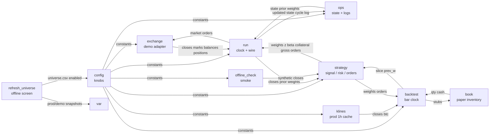
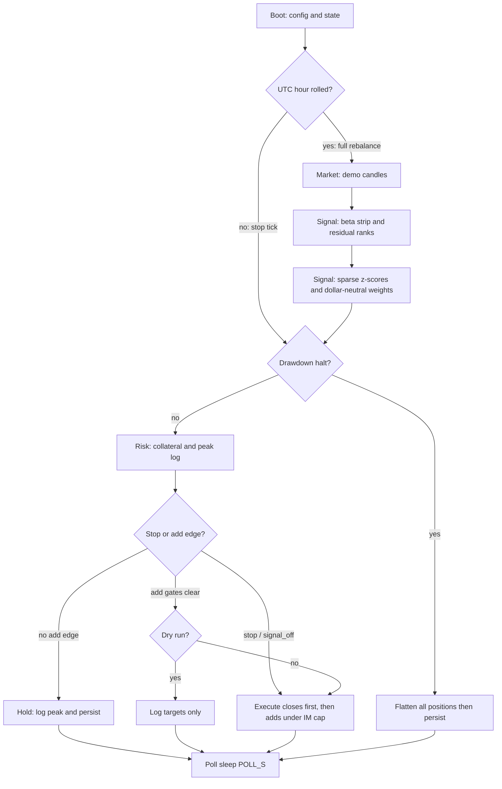

# Residual futures trader

Repo: **an-cszn-core**. Dollar-neutral residual fade vs Bitcoin on Binance USDT-M demo futures. Bitcoin is the factor only. Fixed clock, fixed rules, scarce risk.

Index: [backtest](cszn-backtest.md) · [constitution](cszn-backtest-constitution.md) · [universe](cszn-universe.md) · [ledger](cszn-ledger.md) · [CSZN](CSZN.md)

## Concern graph

Each file is a node. Edges are the data that pass between nodes.

## Files

| File | Role | Input | Output |
|---|---|---|---|
| `cszn_trader/config.py` | Knobs only. | Environment file. | Module constants. |
| `cszn_trader/strategy.py` | Pure math. | Closes, margin, weights, prices. | Weights, budgets, order stubs. |
| `cszn_trader/exchange.py` | Demo Hypertext Transfer Protocol client. | Credentials and method arguments. | Candles, marks, balances, fills. |
| `cszn_trader/ops.py` | Persistence and kill switch. | State dictionary and margin. | Updated state and log path. |
| `cszn_trader/run.py` | Wires the graph on a clock. | Client and state. | Orders, logs, sleep until wake time. |
| `cszn_trader/sim/offline_check.py` | Offline smoke test. | Synthetic prices. | Printed ranks and orders. |
| `cszn_trader/sim/klines.py` | Production 1h close cache. | Prod fapi or CSV. | Asset closes, Bitcoin closes. |
| `cszn_trader/sim/book.py` | Paper futures inventory. | Order stubs, next close. | Qty, entry, cash, fees. |
| `cszn_trader/sim/backtest.py` | Bar clock for proof of edge. | Panel and frozen knobs. | Scorecard after costs. |
| `cszn_trader/sim/refresh_universe.py` | Offline universe screen. | Prod + demo REST. | `var/universe_*.csv`; `--apply` → frozen list. |
| `cszn_trader/tools/sync_ledger.py` | Standalone income ledger. | Demo `/fapi/v1/income`. | Append-only `var/income_ledger.csv`. |

There is no `binance_futures.py`. The adapter lives in `exchange.py`. The backtester never calls it.

Universe membership is `cszn_trader/universe.csv` (`enabled=1`). The poll loop never rewrites it. Runtime caches live in `var/` (`state.json`, klines, ledger, screen snapshots).

## Strategy sub-nodes

| Sub-node | Methods | Input | Output |
|---|---|---|---|
| signal | `rolling_beta`, `residuals`, `residual_signal`, `cross_sectional_z`, `sparse_z`, `dollar_neutral_weights`, `beta_neutralize`, `apply_weight_deadband`, `target_weights` | Asset closes, Bitcoin closes, prior weights | Unit-gross weights, z-scores, betas |
| risk | `collateral_from_margin`, `gross_notional_budget`, `derived_im`, `cap_name_weights` | Margin, positions, marks | Collateral cap, gross budget, estimated initial margin |
| orders | `cost_floor`, `rebalance_orders`, `stop_flatten_orders` | Weights, prices, positions, entry, unrealized, gross | Order stubs with `exit_reason`, closes first |

Beta hedge runs only inside names that pass the z-score floor, so weak names stay at zero weight and portfolio Bitcoin exposure stays near zero on the active set.

## Exchange client

| Method | Input | Output |
|---|---|---|
| `klines` | Symbol, interval, limit | Candle rows |
| `mark` | Symbol | Mark price |
| `filters` | Symbol | Lot step and minimum notional |
| `balances` / `margin_balance` | None | Margin and available (one account snapshot) |
| `position_book` | None | Qty, entry, mark, unrealized |
| `set_leverage` / `market` | Symbol, side, quantity | Order response |
| `income_since` | Start time | Sums by income type |
| `detect_hedge_mode` | None | Hedge-mode flag |

## Operations

| Method | Input | Output |
|---|---|---|
| `load_state` / `save_state` | Path or state | State dictionary or disk write |
| `weights_from_state` | State | Prior weight series |
| `log_cycle` | Cycle row | Append path under `logs/cszn/` |
| `update_peak_and_kill` | State and margin | State, possibly halted |

## Run cycle stages

`once` is two modes. Every `POLL_S` (default 60s): margin, peak, halt, and per-name stop vs mark. Full candles + z-weights + rebalance run only when the UTC hour rolls (1h signal cannot change intra-hour). Adds still need z-score floor, deadband, and cost floor. Stops flatten immediately (`STOP_PCT` default 0.6% of that name's notional). Underwater names are never increased. No take-profit. Cycle logs always include `margin`, `peak_margin`, `dd_from_peak`, and `n_stop`.

## Default knobs

Knobs live in `cszn_trader/config.py`. Credentials from project-root `.env`. Demo host `https://demo-fapi.binance.com`. Universe: `cszn_trader/universe.csv` (`enabled=1`).

## Limits

There is no automated proof that the residual signal earns money after costs. Demo candle history is short for stable beta. Universe liquidity is not re-screened every cycle. Clearing a halt requires editing or deleting `var/state.json`.
