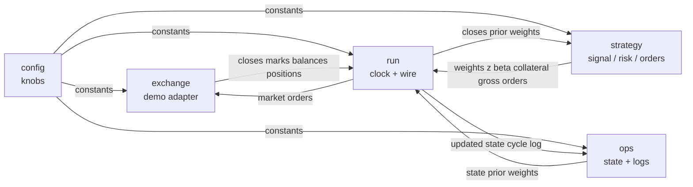
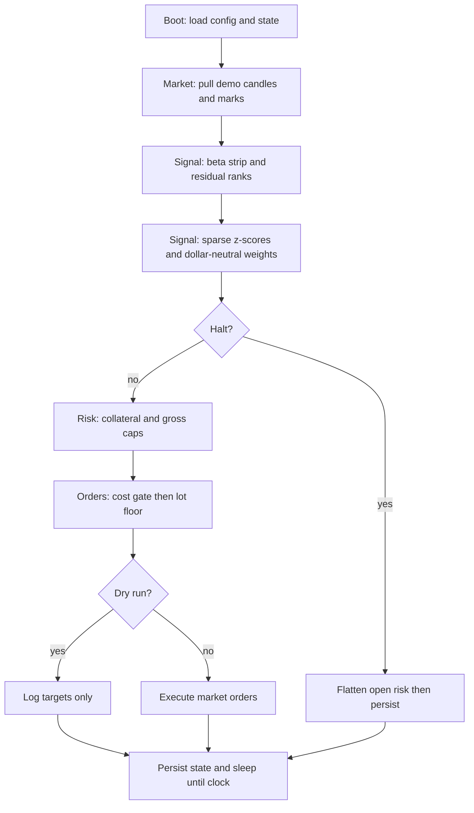

# Residual futures trader

This package trades a dollar-neutral residual book on Binance United States dollar margined demo futures. Bitcoin is the common factor only and is never a target name. The loop is mechanical: fixed clock, fixed rules, and scarce risk.

## Concern graph

Each file is a node. Edges are the data that pass between nodes.

Inside `strategy.py` the same idea repeats as three sub-nodes:

| Sub-node | Input | Output |
|---|---|---|
| signal | closes, Bitcoin series, prior weights | weights, z-scores, betas |
| risk | margin, positions, marks | collateral, gross, derived initial margin |
| orders | weights, prices, positions, gross | order list |

## Files

| File | Role |
|---|---|
| `cszn_trader/config.py` | Settings and traded name list. |
| `cszn_trader/strategy.py` | Factor strip, ranks, size, cost gates. |
| `cszn_trader/exchange.py` | Demo Hypertext Transfer Protocol client. |
| `cszn_trader/ops.py` | Disk state, cycle logs, drawdown halt. |
| `cszn_trader/run.py` | Wire the graph on a fixed clock. |
| `cszn_trader/offline_check.py` | Offline math check without the exchange. |

## Cycle flow

## Limits

There is no automated proof that the residual signal earns money after costs. Demo candle history is short for stable beta. Halt flattens when live; dry run only logs the halt.
